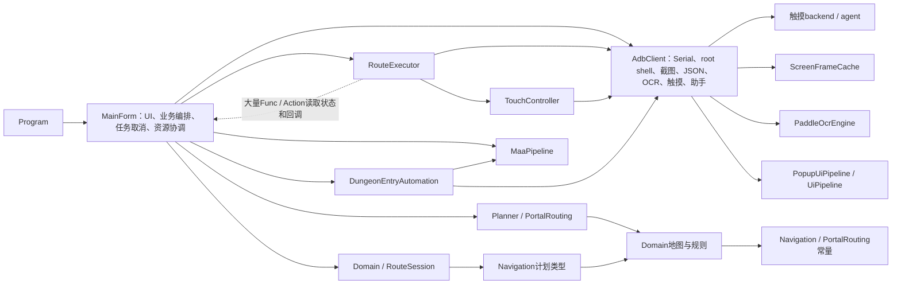
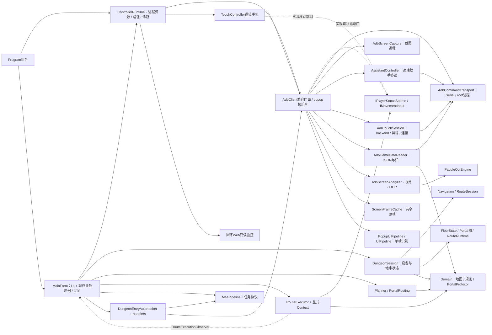

> 历史审计快照：本文基于用户授权全面重构之前的工作区。本轮生产源码已发生后续变化；当前迁移、修复和验证结论见 [FULL_REFACTOR_REPORT.md](FULL_REFACTOR_REPORT.md)。本文的旧源码路径、风险和测试数量保留作为历史证据。

# 架构前后对比

日期：2026-10-09。当前版本：HEAD `1805700b623a505675d5635f5b9be36cc1dfa0e5` 加未提交工作区。审计结论及限制见 REFACTOR_FINAL_AUDIT.md；测试实测见 REGRESSION_REPORT.md。

## 1. 可比较基线

结构参照使用可获取的 `7f9ff2bc3e46f3f46178b3ac4a70617b2f1eaee0`，它位于 `b8d5f78`、`1805700`提取提交之前。Git中可直接取到该版本MainForm、AdbClient、RouteExecutor和Domain/RouteSession；不是凭PROJECT_ANALYSIS的行数推测旧实现。`b8d5f78`已有组件字段及Serial委托，`1805700`已有Runtime/Session/Tracker和端口，所以仅用HEAD父提交会遗漏第一次提取的实际起点。

不过7f9ff2b已有Domain/Navigation目录、RouteSession和ScreenFrameCache，不是完全无模块的初始代码。RU-01原始“缺声明”的未提交红色源码没有独立Git快照，不能可靠恢复。以下只比较可获取版本的结构；没有执行历史版本，不报告跨版本动态业务等价或纯重构的精确效果百分比。

可复核命令（只读）：

```powershell
git show 7f9ff2b:outputs/adb_map_controller/Navigation/RouteExecutor.cs
git show 7f9ff2b:outputs/adb_map_controller/Infrastructure/Adb/AdbClient.cs
git diff 7f9ff2b 1805700 -- outputs/adb_map_controller
git diff HEAD -- outputs/adb_map_controller
```

当前新增文件为untracked，最后一条git diff不会包含它们，必须同时读当前文件与git status；本审计已这样处理。

## 2. 旧架构：7f9ff2b实际结构

箭头表示使用；虚线表示回调或owner关系。图没有把尚不存在的Application目录画入旧版本。



旧源码证据：RouteExecutor.cs:11～41直接持有AdbClient/TouchController及大量状态getter/setter/observer委托；AdbClient.cs:18～58持有rootShell、锁、触摸backend、屏幕参数、JSON options、frame cache和OCR；Domain/RouteSession.cs:12～13,32引用计划类型；MapIconCatalog引用PortalRouting分类码。单程序集内存在目录级Domain↔Navigation依赖，没有“两个csproj循环”的证据。

## 3. 新架构：当前实际结构

这是当前图，不是TARGET_ARCHITECTURE里尚未实施的理想Application用例层。



源证据：MainForm.cs:17～25,58～74,125；ControllerRuntime.cs:18～43；DungeonSession.cs:7～96；RouteExecutor.cs:11～20,26；RouteExecutionContracts.cs:6～61；AdbClient.cs:15～50,268～275。

### 依赖变化与未完成部分

| 边界 | 旧版本 | 当前 | 判断 |
| --- | --- | --- | --- |
| Domain→Navigation | RouteSession计划类型、图标分类常量 | RouteSession归Navigation；PortalProtocol归Domain | 已清除已知反向引用，本次隔离编译/应用类型负例通过；System.*引用筛选仍放行WinForms，V2-06 |
| Navigation→设备 | Executor直接持有AdbClient/TouchController | 仅IPlayerStatusSource/IMovementInput | 真实隔离，fake路线执行独立测试不需ADB |
| Executor→UI | 多个Func/Action读取/写回窗体状态 | 显式Context/runtime/session + observer | 减少隐式状态获取；observer回UI仍存在，是有意适配 |
| MainForm→资源 | 广泛组织具体设备与进程级资源 | Runtime统一构造/释放，MainForm仍调用门面并编排业务 | 部分达标；完整Application用例层未实施 |
| Application→Infrastructure | 无Application模块 | ControllerRuntime直接持有具体资源 | 组合根例外被目标文档允许，不认定新反向违规 |
| AdbClient→具体实现 | 大量同类内联实现 | 六个真实协作者及cache | 修改范围缩小，转发次数增加但资源/协议边界清楚 |
| Assistant→AdbClient DTO | 无独立助手组件 | 返回AdbClient.AssistantStatus | 内部类型耦合可保留；没必要为一个DTO造Contracts包 |
| Pipeline→业务 | handlers/业务上下文 | generic runtime + handlers，MainForm仍作TState | 引擎本身不创建UI/设备；应用用例尚留窗体 |

## 4. 数量只作辅助

本次一致口径：生产C#排除tests/publish；行数按文本换行计数（含末尾空行）；类型是正则匹配class/interface/struct/enum/record声明数量，包含partial重复声明和可能注释命中，不是唯一运行时类型数。不能用它评判复杂度改善。

| 版本 | 生产C#文件 | 文本行 | 类型声明近似数 |
| --- | ---: | ---: | ---: |
| 7f9ff2b | 60 | 15555 | 197 |
| b8d5f78 | 60 | 15559 | 197 |
| HEAD 1805700 | 75 | 16223 | 218 |
| 当前工作区 | 80 | 16249 | 223 |

PROJECT_ANALYSIS写16212行，与这里的16223有换行/统计口径差别，不做精确“增长率”推导。当前Domain仍8文件（移出RouteSession、移入PortalProtocol），Application3文件。生产代码总量几乎没有下降，收益来自边界、可测试性与删除重复实现，不能声称简化了游戏算法本身。

Git中7f9ff2b没有本项目tests目录；HEAD有主测试工程原6例、源链接baseline52例；之后主生产引用增加/接回至54，历史142/156，再到本次165。历史主测试增加9个触摸/关闭案例已在本次开始前存在，本次未新增到已有测试工程。当前独立51相较52减少1来自LootConfirm删除，不是“漏发现一个测试”。统计明细见回归报告。

## 5. 职责与状态所有权

| 状态/资源 | 旧owner | 当前owner | 实际改善/限制 |
| --- | --- | --- | --- |
| UI控件/显示选择 | MainForm | MainForm | 正确保留 |
| 地图/路线/速度/目标/楼层/门户 | MainForm字段与RouteSession | DungeonSession内RouteSession/RouteRuntime/graphs；MainForm通过别名访问 | 单一存储，Reset/Stop可测试；调用顺序仍由UI编排 |
| run/entry/slice CTS、活动任务、watchdog | MainForm | MainForm | 未发生Application owner转移；不得说RU-12已完成 |
| 进程资源构造释放 | Program/MainForm协调 | ControllerRuntime，MainForm异步关闭握手 | 组合与资源拥有集中；Dispose本身不保证活动native已结束 |
| Serial/root状态/持久shell | AdbClient | AdbCommandTransport | 一个serial字段/一个root Process/一个shell锁 |
| backend屏幕规格/连接 | AdbClient | AdbTouchSession | 独立生命周期实现；逻辑held仍在TouchController，物理接触在backend |
| 共享Bitmap与clone | ScreenFrameCache/调用者 | 同owner形态，截图进程独立到ScreenCapture | 历史cache仍有V2-01竞态，未因组件提取自动解决 |
| JSON文件读取/归一 | AdbClient | AdbGameDataReader | 有完整实现，非只转发；无第二份地图缓存 |
| OCR/识别参数 | AdbClient/Paddle | AdbScreenAnalyzer/Paddle | native生命周期可定位；仍依赖外部await前置契约 |
| 助手文件/备份/安装 | AdbClient | AssistantController | 删除重复协议实现，不把设备备份当Git回滚 |
| Pipeline计数/branch | 每引擎实例/运行 | 保持MAA实例顺序使用、Task run-local、UI context-local | 语义隔离是收益；未强行统一 |

MapSnapshot仍持有同一可变MapDump引用；它捕获Level/Player/hash，但不是深快照。MapPanel引用地图用于展示，不能当另一权威数据owner。MainForm pending flags与MotionInterrupt是先锁存后消费；其同步/清理成本残留，未来迁移应搬完整交接边界。

## 6. 行为与公开API差异

这些是当前对HEAD可见的混合改动，不擅自归因于某个RU，不能全部称为“保行为重构”。

| 差异 | 源码证据 | 意义与当前保障 |
| --- | --- | --- |
| 自动进图真正确认地图切换 | DungeonEntryAutomation.cs:20,48,83～89,129～145；dungeon-entry-pipeline.json:15～20,78～103 | 新增mapBeforeChallenge/HasEnteredDungeon；DirectHit改Custom，20s候选等待、optional ConfirmEnter、OpenMapButton重试限制；PipelineContract覆盖离线分支与静态predicate，尚无旧/新真实设备对照 |
| 原初试炼卡层规则 | CardFloorPolicy.cs:19,41 | 新增mode16上限10；CardFloorPolicyTests5例；是业务规则新增 |
| Loot公开能力删除 | HEAD AdbClient.HasLootConfirmButton、MovementPopupKind.LootConfirm及阈值理论用例，当前不再存在 | README解释无生产watchdog节点/流程调用，现引用搜索为空；属于公开API形状变化，即使内部不使用也不能说所有公开签名保持；无外部调用方证据，不推测外部回归 |
| 异常关闭等待修复 | MainForm.Movement.cs:377～384 | sequential await改WhenAll；ShutdownResourceTests移动失败后仍等entry通过；是已修复缺陷，不继续列为未解决 |
| 诊断旁路/API增加 | NonCriticalDiagnostics、SettingsStore可选sink、ControllerRuntime.Diagnostics、Web /api/diagnostics | 增加观测，默认值/容错保持；非关键sink错误隔离 |
| 路线公开契约变化（相对7f） | 旧Execute(token)/多参构造；现Execute(context,token)、ExecuteDetailed(context,token,interrupt)及2端口构造 | 有意内部应用API重构，全部当前调用已构建；未保留所有旧外部二进制兼容，项目无公开库兼容承诺 |

重复游戏包Root文本仍在reader/assistant各一处；立即统一profile会扩大范围。Connect切serial先transport setter reset又显式reset，是冗余幂等调用，实际不是两个serial/root状态。门面转发是保护调用点的兼容成本，换来完整下层职责，当前值得保留。

## 7. 是否更容易维护

**是，局部改善有源码与测试依据。** 定位root命令、截图、助手、地图解码、视觉规则可直接进入owner；更改路线算法不需具体ADB；Domain守卫可阻止原反向应用类型，但尚不能阻止直接WinForms框架引用；配置/JSON故障有消费入口；取消和Reset/Stop有表征测试。

仍需同时理解UI与session才能改RunLoop/转场；MAA parser/runtime、Planner和视觉算法仍复杂。它们并不因多拆十个Service而自动变简单。当前新增间接调用主要为真实职责边界，没有显著过度DI；不建议为减少文件行数、统一Pipeline、拆程序集或完成RU-12标记继续重构。
