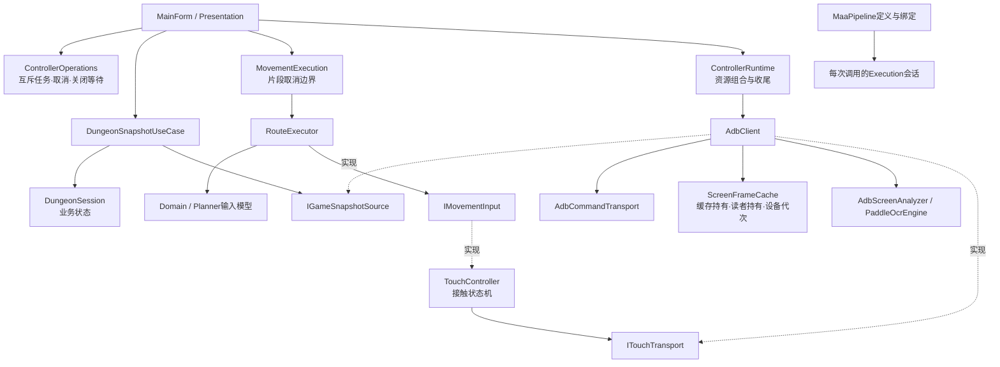

# 全项目架构重构执行报告

日期：2026-10-09。范围：adb_map_controller 当前完整工作区。用户在架构审计后授权直接全面重构，并允许在底层重建时修复缺陷；另明确授权正常关闭控制器后构建、测试。本轮未提交 Git、未执行发布、未自动连接设备、安装助手或修改设备文件。正常关闭使用 CloseMainWindow，原进程 88044 已退出，未强制终止。

## 1. 基线与结论边界

本轮起点是带大量既有修改的工作区，不是干净的 HEAD。HEAD 为 `1805700b623a505675d5635f5b9be36cc1dfa0e5`。审计结束、重构开始前的源码/config/scripts 文件指纹为 `BA0BC3CB87041FD0D3403CAEDD24248809950AA31AD5FFC253FF1830D831A30E`。不能把当前 git diff 全部归于本轮。

既有 CardFloorPolicy、自动进图资源、助手脚本和发布目录修改没有被重置。原四份审计文档保留为重构前的历史证据，不应作为本轮修改后的源码结论。独立 Baseline 仍是来源链接的兼容性表征子集，主测试仍引用真实生产程序集；两个测试数量不能相加成互不重复的业务验收数。

本轮围绕 Application、设备会话、共享帧/native 资源、触摸状态机、Pipeline 和架构守卫重建完整边界，并迁移所有生产调用。Planner、游戏协议、任务选择和时序策略保留现有实现，不为减少文件长度引入新的通用 Manager。

## 2. Application：运行所有权与用例

| 边界 | 修改及源码 | 验证 |
| --- | --- | --- |
| 自动化任务 | `Application/ControllerOperations.cs` 统一持有任务、取消源、入场互斥和关闭准入；跑图、点击导航、单步、挖矿共用 Movement 槽，自动进图使用 Entry 槽；两个槽互斥 | 停止后等待收尾、关闭拒绝新任务、异常释放准入、窗体关闭对 Movement/Entry/故障三路径 |
| 窗体生命周期 | `MainForm.cs` 删除 runCts、entryCts 和可写 activeMovement/activeEntry 字段。只投影 Application 的任务状态。`MainForm.Movement.cs` 将看门狗运行和收尾纳入同一个操作任务 | `ShutdownResourceTests` 通过真实 Application 操作注入等待，不再伪造多个字段所有者 |
| 移动片段 | `Application/MovementExecution.cs` 创建、取消、回收片段令牌，串行准入，区分弹窗抢占与所属运行取消 | 弹窗只取消片段、所有者取消不能被解释为弹窗处理成功 |
| 地图快照 | `Application/DungeonSnapshotUseCase.cs` 通过 `IGameSnapshotSource` 读取完整地图和人物，完成读取及取消检查后提交会话；集中更新速度、传送门解锁/跳转学习、机关踩中和快照 | 取消不提交半份快照、位置/速度提交、层内传送学习并消耗落地入口；原 PortalLearning/StateJson 保留 |
| 启动编排 | `Application/NavigationStartupUseCase.cs` 接管原 NavigationStartup；规划与覆盖层检查并行，但必须等待两个分支结束才能允许输入 | 原 OperationLifecycle 并发/失败测试保留；旧 Navigation 文件删除 |
| 运行结果 | `MainForm.Automation.cs` 将同一个操作令牌传入 MAA；RunLoop 不再吞掉异常和取消；退出释放失败必须传播，执行与释放同时失败保留 AggregateException | Pipeline 原取消/失败契约、任务故障传播测试；未声称完整游戏 RunLoop 已被端到端重放 |

状态边界：DungeonSession 继续唯一持有地图、路线、学习结果和楼层状态；ControllerOperations 持有任务及运行取消源；MovementExecution 持有短生命周期片段；TouchController 持有设备接触的不确定状态。MainForm 中的动作取消源和片段锁已删除，TouchController 的隐式 MovementCancellation 已删除，所有手势调用使用显式令牌。

MainForm 仍保留具体游戏用例的部分编排、控件选项读取和弹窗锁存。没有通过一个包含几十个转发方法的接口把它机械搬到另一类。这个部分仍是后续维护成本，不能声称 Presentation 已经完全不含业务逻辑。本轮没有将全部游戏策略重写成新框架。

## 3. Infrastructure：真实资源边界

### 共享帧

`ScreenFrameCache` 改为每个帧 ID 的在途操作字典、设备代次和等待者持有计数。所有 Bitmap 克隆和释放均在同一个资源锁下完成。缓存淘汰仅释放缓存的持有，尚未恢复的读者继续拥有原帧；Clear 清空当前代次，不允许旧截图回填新缓存。单个读者取消不取消共享截图，取消后移除自身持有；所有读者取消、旧代次完成时也能释放资源。Dispose 拒绝后续请求和晚到截图。

本轮修复审计 E01（发布后 Clear 导致读者克隆已释放 Bitmap）及 E02（Clear 后旧在途截图回填缓存）。`RefactorFoundationTests` 包含 UI 排队恢复场景、同 ID 跨代次、新旧帧交错以及取消读者测试。原 Fake ADB 截图共享、淘汰、Disconnect、晚到 Dispose 测试继续运行。

### 触摸

`ITouchTransport` 是 TouchController 实际消费的设备能力端口，由 AdbClient 实现。TouchController 不再依赖具体 AdbClient；测试使用类型明确的离线传输，不反射修改 AdbTouchSession 的私有字段。

接触状态从“成功后才登记、释放前就遗忘”重建为“可能按下，直到释放确认”。部分 down/swipe 写入失败和 up 失败均保留不确定接触；下一次显式急停可以释放或重试。没有新增自动循环重试。正常 down→up→方向切换、单次 swipe、手势串行和急停等待前序输入的顺序不变。

这是有意的故障行为变化：两项旧测试改为验证显式补偿释放和显式释放重试；不是删除失败断言。新增 partial swipe、观察者异常不覆盖原始传输错误、Dispose 后拒绝输入测试。同步 Dispose 关闭准入并等待在途手势；实际设备释放仍由操作关闭流程在资源销毁前完成。

### ADB/native 生命周期

`AdbCommandTransport` 在同一个 shell 锁下切换序列号、重置、执行 root shell 和关闭 shell；root I/O 不捕获 UI 上下文，避免关闭在等待锁时形成 UI 互等。普通 ADB 子进程登记在传输所有者内，Dispose 关闭准入并终止尚未退出的自有命令进程。保留原命令、root/su、marker、退出码及 5s/3s 超时契约。

移除 Serial/Connect 链路上的重复 transport reset。AdbTouchSession 关闭准入，等待连接初始化结束再回收后端；旧分离的 DisposeBackendForOwnerDisposal/DisposeLocks API 删除。PaddleOcrEngine 先关闭识别准入，再等待同步 native inference 结束，最后 FreeEngine；已经排队的调用能安全拒绝。相关 SemaphoreSlim 保留给已排队调用完成拒绝，不在仍可能 Release 时销毁。

ControllerRuntime 的并发 DisposeAsync 共享同一个收尾任务。AdbClient 与 ControllerRuntime 对所有资源分别执行回收，再聚合错误，避免前一个异常跳过后续释放。同步/异步关闭不等于真实设备故障恢复已验收；native 极端并发和真机触摸故障仍需设备层证据。

## 4. Pipeline 与识别

MaaPipeline 的定义/编译移入 `MaaPipelineDefinition.cs`，结果/handler/trace 契约移入 `MaaPipelineContracts.cs`，legacy 适配移入 `MaaPipelineHandlerAdapter.cs`。这些文件承担不同职责；拆文件本身不算核心改进。

核心改进是每次 RunAsync 创建独立 Execution 会话：runId、任务 ID、分支、跳转计数和执行次数不再属于可复用 Pipeline 实例。目录的延迟编译通过独立锁保护，Names 返回快照。交错运行测试保证两个运行各自执行一次、拥有不同 trace ID。设备 handler 的并发安全仍由其能力决定；生产 ControllerOperations 不并行运行设备自动化。

保留 TaskPipeline 与 UiPipeline：前者的受限工作流与后者的单帧优先识别语义不同，不以存在多个类为由合并。MAA public 类型、字段、JSON 资源格式及现有调用方式保留。

`ConnectionPopupRecognition.cs` 集中断线弹窗的视觉候选和语义分类。保留绿色按钮连接异常变体，增加实际样本中的橙红按钮闲置断线变体；要求中央中性面板、按钮候选和观察到的语义组合同时满足。没有只扩大一个泛化子串。

真实样本 `server-idle-disconnect.png` 已通过本机 native PaddleOCR → Popup UI Pipeline 被识别为 ServerError；正常游戏/换层/宝石/贪婪截图负例继续通过。单张截图回放不证明多分辨率、动画或真实看门狗设备路径完整正确。

## 5. Domain、Navigation 和架构守卫

Domain 保持 BCL-only，Navigation 仍通过输入、设备端口和观察者工作。新版编译守卫只引用 .NETCore runtime 所在目录，排除 WindowsDesktop；修复原守卫将所有 System.* 桌面程序集纳入的漏洞。Domain/Navigation/Application 用例均独立编译，负例拒绝 AdbClient、MainForm、WinForms；Domain 另拒绝 Bitmap。ControllerRuntime 是明确的组合边界，未被伪称为纯业务用例。

Fixture 纳入递归目录，并继续使用真实生产 ProjectReference 做行为测试。独立 Baseline 跟随文件迁移链接真实源文件，未拷贝另一个“能过测试”的实现。

JSON 容错诊断现在最多保留 128 项、每项最多 512 字；楼层非法转移历史最多 128 项，DungeonSession.Reset 清空它。保留无效转移仍应用、JSON 非法值仍修正为原默认值的兼容性。两类队列上限与重置都有测试。

Planner、RouteExecutor 正常执行算法、PortalRouting 协议分类、CardFloorPolicy、矿区计算、助手注入协议、本地 OCR 临时 ASCII runtime 路径保留。收益不足以证明需要重写这些已可独立测试的模块。

## 6. 新依赖与所有权

没有新增 Domain→Infrastructure 或 Navigation→Presentation 依赖。Application 用例可用 BCL、Domain 和 Navigation 编译；运行期资源组合是单独的明确例外。

## 7. 工程验证

最终结果在完成后填写，见下方附录。测试结果文件保存在对应测试项目的 publish/test-results 下。所有构建、中间文件均使用已有 Directory.Build.props 路径，未创建项目外 bin/obj 或备用发布目录。

执行：Release 生产构建、主测试工程、独立 Baseline；主测试包含 Fake ADB、资源配置、原架构守卫、扩展架构守卫、native 视觉、Pipeline 和新的资源/操作边界测试。未运行会自动 Force 停止程序或执行 Publish 的验证脚本。

前一轮已有 .audit-harness/.audit-results 清理曾被自动审批策略拒绝；本轮没有通过另一个 API 绕过该拒绝。测试 TRX 是验收证据，有意保留。构建输出不等于新的发布程序；标准 publish 根目录的可执行文件未被本轮发布覆盖。

## 8. 尚未验证与下一步

- 未进行真实设备回归。M01～M08 不能因为本轮测试通过而改为通过。
- 真机断线/重连、设备切换中在途动作、触摸部分写入及释放失败、OCR/native 关闭压力、长时间楼层转场恢复，仍需明确场景和事件记录。
- MainForm 中的楼层、矿区、战斗与交互用例尚未全部迁出，RunLoop 仍有真实业务复杂度。进一步迁移应以完整用例、输入快照及事件回放为单位，不能再加一组只负责转发的 Service。
- 本轮证明的是模块边界、离线兼容性、可控故障及 native 截图识别；没有把编译、模拟器命令 Fixture 或截图回放混同为设备端到端验收。

建议下一步先做本轮变更评审和受控设备回归，再决定剩余游戏用例是否值得继续迁移。未发现需要立即更改 Planner 或设备协议的证据。
