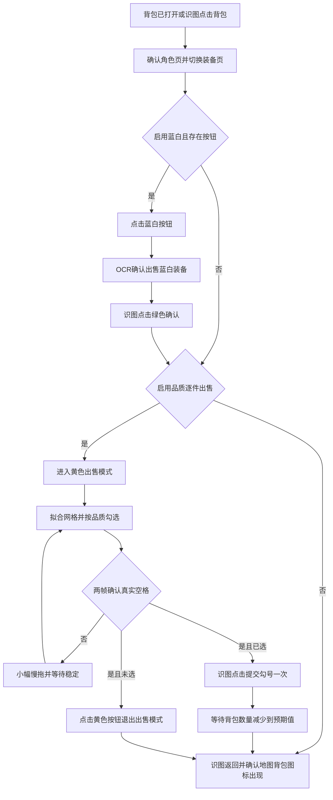

# 识图装备出售

运行页新增“一键售出”；通用设置页提供“商人自动售出”和蓝白、紫色、暗金、金色、红色选项。自动出售默认关闭，紫色、暗金、金色、红色默认关闭。任务编辑器不提供出售选项，任务运行统一使用通用出售设置，忽略旧任务中保存的出售字段；保存配置时仅在通用配置保留出售字段。

自动入口复用跑图已有的地图标题“神秘商人”，同一次进入只执行一次。进入背包后的判断只使用截图、OCR 与触摸，不读取游戏装备数据。手动入口与跑图共享操作互斥、暂停和取消，出售期间暂停通用弹窗看门狗。

## Pipeline 配置

源码配置：`Resources/Automation/equipment-sale-pipeline.json`。交付配置：`publish/pipelines/equipment-sale-pipeline.json`。按钮模板永久保存于 `Resources/UiTemplates/EquipmentSale/`，发布至 `publish/templates/ui/EquipmentSale/`。

所有识别坐标使用 1004×565 的截图参考空间，设备截图先按此尺寸归一化。ROI 约束搜索区域，点击坐标来自当前模板匹配或当前装备方框检测；不能把 ROI 中心当作按钮坐标。当前适配用户提供的横屏布局。

节点的 `next`、`template`、`roi`、`templThreshold`、`timeout`、`rateLimit`、`postDelay`、`maxTimes` 由现有 MAA Pipeline 引擎执行。`$settings` 控制慢拖距离、持续时间、稳定等待、扫描上限；`$settings.vision` 控制背景间隙覆盖率、拟合误差、品质色相与饱和度、选择框颜色容差和空格纹理阈值。色相使用 0～360 度；RGB 使用 0～255。

默认慢拖 90 参考像素、1200ms，松开后等待 650ms。最多扫描 400 次；连续三次拖动后内容不变且无空格则失败。返回按钮最多点击 12 次。点击后的 `checkTimeoutMs` 默认 2000ms，`checkIntervalMs` 默认 150ms；`vision.selectedCheckTemplate` 指定黄色勾号图片，`vision.selectedCheckThreshold` 默认 0.97。

`scrollGapColumn` 默认 2，取值 1～4，指定依据当前网格推算的内侧列间隙；慢拖沿间隙移动，避免装备内部的短慢拖同时触发勾选。日志记录本次品质开关与拖动路径。已勾选装备只识别勾选状态，不再判定品质，也不会执行取消操作。

## 专用识别节点

蓝白按钮缺失时，逐件出售按钮可能移到右侧。各逐件出售状态节点的 ROI 覆盖两种位置；`BlueWhite` 在同一位置比较蓝白与逐件出售模板的得分，避免灰色背景相似导致误点。`SkipBlueWhite` 使用同一判定。`ResumeSelection` 接续黄色或勾号出售模式；已有勾选保留，并计入最终提交条件。

`Scan` 从面板灰色背景估计间隙，分别投影到横纵方向，提取连续间隙并拟合等距序列。横向须有五列和至少四条真实边界支持，纵向须有连续行边界，行列间距差不超过 6%。勾选标记遮住少量列间隙时，可以用其它实测边界补出缺失边界。网格不能通过校验时立即停止。

只检查完整、非渐隐的格子。先用黄色勾号模板识别已选装备；已选格子直接跳过后续品质取色。未选格子的品质根据去图标后的底板主色判定：先排除暗色和低饱和度的选择框等像素，将 RGB 各通道按 16 级归组，并把四个角区一同纳入候选取色。候选颜色不再受角区重复数量限制，只要求与原图至少两段品质框的色相一致，其中至少一段位于左侧或右侧。按出现次数检查候选；第一个通过品质框校验的颜色即为底板色，不继续寻找图标颜色。红色有独立品质和出售开关，默认关闭。校验未通过便保持未知并跳过。格子右上区域的指定灰色方框决定点击点。点击前重新截图核对品质和选择状态；点击后只在保存的点击位置周围 36×36 区域轮询勾号模板，允许小幅偏移，不重算网格，不再次点击。超时停止；日志记录点击坐标、模板得分、等待时长与命中结果。

空格需要低纹理、暗色、无品质边框、无选择框，且相隔稳定等待的两帧在同一位置均为空。检测到空格后仍检查同页其它装备，再停止滚动。未识别到选择框不能作为末页判据。

点击确认出售后直接判定出售成功，立即进入返回关闭背包流程，不执行出售数量 OCR、数量变化或按钮恢复验证，也不重复提交。无勾选则点击黄色按钮关闭模式，确认灰色恢复。关闭背包必须确认角色页消失且地图背包图标重新出现。

失败时执行 Pipeline 的 `Cleanup` 分支：循环识图点击返回按钮，确认背包关闭。失败结果仍保留原始错误；善后关闭未确认时追加原因。用户取消不触发新的触控。日志及 `publish/pipeline-traces/equipment-sale-*.json` 记录节点与原因。未进行真实游戏装备出售。

## 验证

`tests/EquipmentSaleTests.cs` 使用用户截图验证网格、品质、空格、右上点击位置及勾选状态，使用模拟设备回放蓝白确认、缺少按钮、无符合品质、选择提交、慢拖停滞和结果未确认分支。NativeOCR 测试使用交付包的 PaddleOCR 运行库验证确认文字及背包计数；其运行依赖需复制至测试输出的 `PaddleOCR/` 中。测试输出及运行依赖全部在对应项目 `publish/` 内。

实际设备上的慢拖速度、按钮动画和背包计数 OCR 仍需联调；本次验证未发送游戏出售操作。

点击前重新拟合当前截图网格；点击前识别为 `Unknown` 时直接跳过该装备，继续检查后续格子，不重新扫描也不判失败。其它网格位置、品质或未选方框与扫描时不一致时，不点击旧位置，等待 `settleDelayMs` 后重新扫描。`stateRefreshRetries` 默认 3；成功勾选会重置刷新次数，仅连续没有勾选进展的位置变化达到上限才失败善后。局部刷新不计作拖动停滞。

商人自动出售属于可选步骤：失败或异常只记录警告，善后结束后继续跑图和任务链。同一次商人地图访问只尝试一次，离开后重置；用户停止/取消仍正常中断任务。
