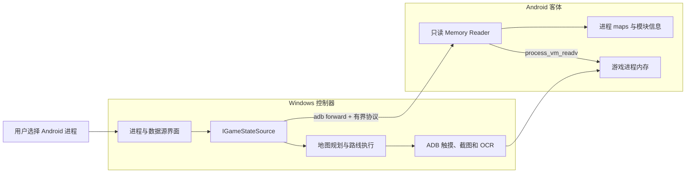
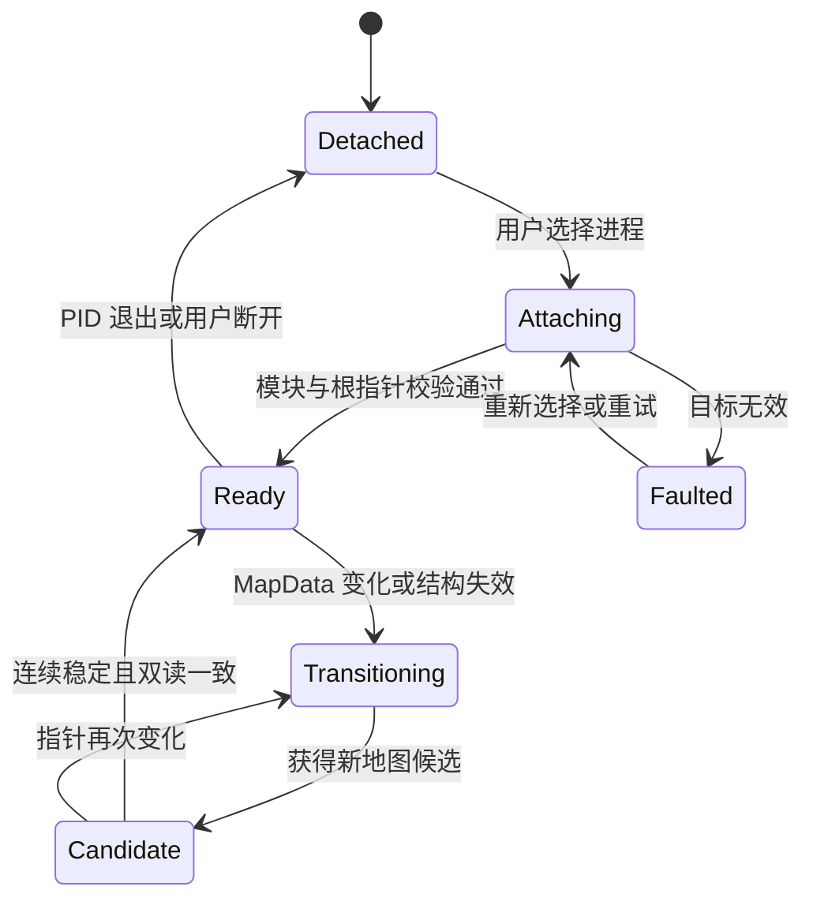

# Android 游戏内存读取方案实施任务书

本任务书用于把现有“Lua 助手生成 JSON、Windows 控制器经 ADB 读取”逐步迁移为“Android 客体内只读内存读取服务、Windows 控制器直接接收快照”。

> 重要限制：第一阶段只替换人物坐标、速度、层数等高频状态。只有在稳定根指针和完整地图一致性通过验收后，才允许停用 Lua 地图助手。内存服务必须保持只读，不实现任意地址写入、冻结数值或脚本执行接口。

## 完成标准

满足以下全部条件后，才能认为迁移完成：

- 用户可以从控制器选择 Android 客体中的目标进程，并看到 PID、进程名、架构和关键模块状态。
- 游戏重启、PID 变化、手动换层和自动换层均能被识别，不会继续使用旧指针或旧路线。
- 高频人物状态不再依赖 `codex_player_status.json`。
- 完整地图与现有助手输出逐格一致，并通过多次重启、换层、战斗和 Lua GC 场景验证。
- 内存源失效时，控制器立即松开方向键并停止路线；在迁移期可回退到助手文件数据源。
- 所有构建和交付物只生成在对应项目的 `publish/` 目录。

## 目标架构



运行时地图生命周期：



## 实施原则

1. 先建立可替换的数据源边界，再接入 native reader，避免把内存协议散落到窗体和路线代码中。
2. 每次采样从稳定根节点重新解析当前对象；不长期缓存 Tile、Role 或 Lua table 的绝对地址。
3. 地图快照必须双读根指针并验证一致性。失败的候选快照不得进入规划器。
4. 底层换层检测与现有业务换层流程分离：前者判断内存对象是否稳定，后者处理传送门、奖励和等待流程。
5. reader 不阻塞游戏进程、不暂停线程，不开放写内存能力。
6. 每个阶段都有独立的退出条件；未通过门槛时保留现有助手方案。

## 阶段 0：建立基线和测试样本

目标：冻结当前行为，确保后续能判断内存数据是否正确。

任务：

- [ ] 记录当前游戏版本、APK 版本、`libcocos2dlua.so` SHA-256、ABI 和包名。
- [ ] 保存至少三层完整的助手地图 JSON 作为逐格比对基线。
- [ ] 为每层同时记录人物坐标、速度、地图宽高、角色种类、迷雾状态和 Boss 预警数据。
- [ ] 补充手动换层、自动传送门换层、战斗返回和游戏重启四类操作日志。
- [ ] 给现有 `RouteLockRegression` 增加“数据源换代但规划输入不变”的基线断言。

验收：

- 基线样本能够被现有 `MapDump`、`PlayerStatus` 正常解析。
- 当前回归测试全部通过。
- 样本和版本信息能够唯一对应目标二进制。

退出条件：基线不完整时不得开始完整地图内存解析，但可以开始进程枚举原型。

## 阶段 1：拆分数据源接口

目标：在不改变现有行为的前提下，解除路线执行器对 `AdbClient.ReadMap()` 和 `ReadPlayer()` 的直接依赖。

建议新增文件：

- `outputs/adb_map_controller/IGameStateSource.cs`
- `outputs/adb_map_controller/GameSnapshot.cs`
- `outputs/adb_map_controller/AssistantFileDataSource.cs`
- `outputs/adb_map_controller/GameSourceState.cs`

建议修改文件：

- `outputs/adb_map_controller/Infrastructure/Adb/AdbClient.cs`
- `outputs/adb_map_controller/Presentation/MainForm.cs`
- `outputs/adb_map_controller/Navigation/RouteExecutor.cs`
- `outputs/adb_map_controller/Domain/Models.cs`
- `outputs/adb_map_controller/tests/RouteLockRegression/TouchRegression.cs`

任务：

- [ ] 定义 `IGameStateSource`，包含枚举、附加、断开、统一快照读取和异步释放。
- [ ] 定义统一 `GameSnapshot`，包含 `State`、`ProcessEpoch`、`MapIdentity`、`Sequence`、`Map`、`Player` 和采样时间。
- [ ] 用 `AssistantFileDataSource` 包装现有 JSON 读取逻辑，确保行为不变。
- [ ] 将 `RouteExecutor` 的数据读取依赖由 `AdbClient` 改为 `IGameStateSource`；触摸依赖继续使用 `TouchController`。
- [ ] 将 `MainForm.RefreshMap()` 改为消费统一快照，禁止把不同代或不同地图的 `MapDump` 与 `PlayerStatus` 合并。
- [ ] 为 `Transitioning`、`Disconnected`、`InvalidTarget` 定义明确的 UI、日志和急停行为。

验收：

- 使用 `AssistantFileDataSource` 时，程序功能、路线规划和换层行为与改造前一致。
- `RouteExecutor` 不再直接调用 `AdbClient.ReadPlayer()`。
- 数据源返回非 `Ready` 状态时，方向键必定释放，路线不再继续。

## 阶段 2：进程枚举与用户选择

目标：让用户选择 Android 客体进程，而不是 Windows 模拟器宿主进程。

建议新增文件：

- `outputs/adb_map_controller/GameProcessInfo.cs`
- `outputs/adb_map_controller/AndroidProcessDiscovery.cs`

任务：

- [ ] 通过 Root ADB 枚举 Android 进程，获取 PID、进程名、UID 和命令行。
- [ ] 读取 `/proc/<pid>/exe`、`maps` 或 ELF 头，判断 ARMv7/ARM64。
- [ ] 检测是否加载 `libcocos2dlua.so`，并显示模块基址和路径是否可用。
- [ ] 在 `MainForm` 增加进程下拉框、刷新、附加、断开和自动识别操作。
- [ ] 允许记住包名，但禁止保存并复用旧 PID。
- [ ] 进程退出后立即清空附加状态，停止采样并急停移动。
- [ ] 拒绝附加缺少预期模块或架构不受支持的进程。

验收：

- 游戏启动、退出和重启后，进程列表与 PID 更新正确。
- 手动选错进程不会进入读取状态。
- 主进程与冒号后缀子进程能够明确区分。

## 阶段 3：Android 只读内存服务与协议

目标：建立类似 Cheat Engine 客体端 reader 的只读通信基础。

建议新增目录：

```text
outputs/android_memory_reader/
├── CMakeLists.txt
├── src/
│   ├── main.cpp
│   ├── process_maps.cpp
│   ├── memory_reader.cpp
│   ├── protocol.cpp
│   └── snapshot_validator.cpp
└── publish/
```

任务：

- [ ] 使用 NDK 构建 ARM64 reader；只有确认需要时再加入 ARMv7。
- [ ] 实现 `/proc/<pid>/maps` 解析和可读地址范围索引。
- [ ] 优先使用 `process_vm_readv` 批量读取；为不支持的环境提供只读 `/proc/<pid>/mem` 回退。
- [ ] 使用 localabstract Socket；由 Windows 端建立仅绑定 `127.0.0.1` 的 `adb forward`。
- [ ] 定义带长度、消息类型、协议版本、序列号和校验值的二进制帧。
- [ ] 设置最大帧长度、读取超时、连接清理和随机会话令牌。
- [ ] 协议仅开放：握手、进程信息、模块列表、批量读取、健康检查和断开。
- [ ] 禁止任意地址写入、冻结、远程 Lua 执行和游戏函数调用。
- [ ] 控制器退出或切换设备时删除对应的 ADB forward。

验收：

- 能稳定读取选定进程中已知只读模块的 ELF 魔数和映射信息。
- 非法地址、超长帧、半包、断连和 reader 退出均不会卡住控制器。
- 反复附加和断开不会留下旧端口或僵尸 reader。

## 阶段 4：高频人物状态读取

目标：先替换 `codex_player_status.json`，验证直接内存读取的实时收益和稳定性。

任务：

- [ ] 定位稳定入口、特征码或根指针，用于获取玩家坐标、移动速度、当前层数和基础状态。
- [ ] 对每个地址链记录模块、特征、偏移、字段类型、范围和失效条件。
- [ ] 每次附加都从模块基址重新解析，不保存绝对地址。
- [ ] 为坐标、速度和层数加入范围校验及双采样一致性检查。
- [ ] 由 Windows 数据源生成单调递增的 `Sequence`。
- [ ] 将采样周期设置为可配置值，初始目标为 20 Hz；验证稳定后再评估更高频率。
- [ ] 在 UI 显示数据年龄、采样延迟、丢弃次数和当前地址链版本。
- [ ] 与助手 `PlayerStatus` 同时采样并记录差异，暂不直接移除助手路径。

验收：

- 连续运行 30 分钟无 reader 崩溃、控制器卡死或游戏明显卡顿。
- 至少十次游戏重启后均可自动重新解析地址。
- 至少二十次换层过程中不会把旧层坐标发布为新层有效状态。
- 坐标、速度和层数与助手基线一致；出现差异时能够拒绝快照并记录原因。
- 通过验收后，路线执行的高频位置反馈改用内存源。

回退：任何验收项失败，都继续使用 `AssistantFileDataSource.ReadPlayer()`。

## 阶段 5：换层自动检测和一致性门控

目标：在不知道换层时机的情况下，自动暂停并重新定位新地图。

建议新增文件：

- `outputs/adb_map_controller/MapTransitionDetector.cs`
- `outputs/adb_map_controller/SnapshotValidation.cs`

任务：

- [ ] 定义 `Detached → Attaching → Ready → Transitioning → Candidate → Ready` 状态机。
- [ ] 监控 `MapData`、Tile 容器、层数、宽高、玩家存在性和地址范围。
- [ ] 实现根指针双读：读取前为 A，采样后为 B，仅接受 `A == B` 的快照。
- [ ] 新地图要求连续 2～3 次相同 `MapIdentity` 且结构校验通过。
- [ ] 检测到换层时立即通知 `RouteExecutor` 松开输入并终止当前路线。
- [ ] 新地图稳定后才通知现有 `FloorStateMachine` 进入 `WaitingFloorLoad` 或 `Explore`。
- [ ] 主动换层只作为提前提示；手动换层必须同样能够触发检测。
- [ ] 防止内存地址复用：`MapIdentity` 至少组合根指针、Tile 容器、层数、宽高和生成摘要。

验收：

- 主动传送门、下一层按钮和手动换层都能触发相同的底层暂停流程。
- 换层期间不会规划、移动或显示旧地图为当前地图。
- 即使新对象复用了旧 `MapData` 地址，仍能识别地图代发生变化。

## 阶段 6：完整地图内存解析原型

目标：证明完整地图可以稳定脱离 Lua 助手。这是全量迁移的关键 Go/No-Go 阶段。

任务：

- [ ] 确认游戏 Lua 版本和 `TValue`、`Table`、`Node`、`GCObject` 的实际布局。
- [ ] 定位稳定的 `lua_State` 或 LuaStack 入口，并形成可跨 ASLR 使用的特征。
- [ ] 从 `package.loaded` 或等价根定位 `app.game.GameMapManager`。
- [ ] 解析单例 `_mapData`、地图宽高和 `tileDataMap`。
- [ ] 解析每个 Tile 的地形、可达、到达、探索和角色列表。
- [ ] 解析 Role 的类别、类型、宝箱类型、怪物分类、开启状态和玩家标志。
- [ ] 对 Lua table 遍历设置节点数、递归深度、字符串长度和总读取量上限。
- [ ] 在 Lua GC、战斗切场景和换层过程中应用根指针双读与结构校验。
- [ ] 为每个支持的游戏版本维护带二进制哈希的只读签名配置。

验收：

- 至少三类地图、二十次换层的宽高、Tile、Role 和迷雾状态与助手逐格一致。
- 不认识的对象被标为未知，不依据图标或未经证实字段强制推断。
- 游戏版本或模块哈希不匹配时明确拒绝完整地图读取。
- Lua GC 压力场景下不会发布半张地图或悬空对象数据。

Go/No-Go：

- 通过：进入阶段 7，将内存地图设为默认数据源。
- 未通过：保留“人物状态读内存、完整地图由助手低频导出”的混合架构，不继续盲目扩大偏移扫描。

## 阶段 7：控制器切换与回退

目标：把通过验证的内存源正式接入用户流程。

任务：

- [ ] 增加 `助手文件`、`直接内存`、`混合模式`三种数据源选项。
- [ ] 默认模式只在模块哈希和签名配置匹配时选择直接内存。
- [ ] 数据源切换必须先急停、清空路线、递增 `ProcessEpoch` 并重新获取完整快照。
- [ ] 完整地图读取失败时自动停止移动；是否回退助手应由显式设置决定，不能静默混用不同代数据。
- [ ] 在日志中记录数据源、PID、ABI、模块哈希、MapIdentity 和所有状态转换。
- [ ] 保留现有截图/OCR，用于弹窗和宝石选择识别。

验收：

- 三种模式均能独立启动、切换和停止。
- 直接内存模式不要求安装 Lua 助手。
- 混合模式下人物和地图快照能够通过层数、MapIdentity 和数据年龄正确对齐。

## 阶段 8：回归、压力与故障测试

必须覆盖：

| 场景 | 预期结果 |
|---|---|
| 用户选择错误进程 | 拒绝附加，不读取任意数据 |
| 游戏重启，PID 改变 | 断开并急停，重新枚举后才能恢复 |
| ADB 临时断线 | reader 连接失效，控制器不继续使用旧快照 |
| reader 被终止 | 立即进入 `Disconnected`，方向键释放 |
| 手动换层 | 自动进入 `Transitioning` 并重新定位 |
| 自动传送门换层 | 业务流程与内存状态机正确衔接 |
| MapData 暂时为空 | 保持等待，不将其当作空地图 |
| 地址被复用 | 通过组合 MapIdentity 识别新地图 |
| Lua GC 发生 | 不发布悬空或不完整快照 |
| 战斗切场景 | 停止移动，返回地图后重新验证 |
| 模块版本变化 | 签名不匹配并拒绝读取 |
| 协议半包或超长帧 | 丢弃连接，不阻塞 UI |

性能指标：

- 高频人物状态目标采样率不低于 20 Hz。
- 控制器主线程不得同步等待 Socket 或内存读取。
- reader CPU 和内存占用需记录基线；不得对游戏产生可感知卡顿。
- 完整地图只在地图代变化或明确请求时重建，不按人物采样频率遍历全图。

## 阶段 9：发布与清理

任务：

- [ ] 发布前检查并终止正在运行的“洞窟地图控制器”。
- [ ] Windows 控制器构建仅写入 `outputs/adb_map_controller/publish/`。
- [ ] Android reader 构建仅写入 `outputs/android_memory_reader/publish/`。
- [ ] 清理 `publish/` 外的 `bin/`、`obj/` 和临时构建目录。
- [ ] 发布目录只保留可运行程序、reader、签名配置和运行依赖。
- [ ] 验证全新环境能够从标准 `publish/` 目录直接运行。
- [ ] 只有完整内存地图通过阶段 6 和阶段 8 后，才移除助手安装入口和 Lua 模板发布项。

最终交付路径：

```text
outputs/adb_map_controller/publish/洞窟地图控制器.exe
outputs/android_memory_reader/publish/<ABI 对应 reader>
```

## 任务依赖和并行关系

| 工作项 | 依赖 | 可并行内容 | 交付门槛 |
|---|---|---|---|
| WI-001 基线样本 | 无 | 进程枚举调研 | 回归输入固定 |
| WI-002 数据源抽象 | WI-001 | reader 协议设计 | 助手模式行为不变 |
| WI-003 进程选择 | 无 | WI-002 | 错误目标可拒绝 |
| WI-004 native reader | WI-003 | WI-002 | 稳定只读模块数据 |
| WI-005 人物状态 | WI-004 | UI 指标 | 跨重启与换层一致 |
| WI-006 换层检测 | WI-002、WI-005 | 完整地图逆向 | 不使用旧地图 |
| WI-007 完整地图 | WI-004、WI-006 | 回归夹具扩展 | 与助手逐格一致 |
| WI-008 正式切换 | WI-005、WI-006；全量模式还需 WI-007 | 故障测试 | 回退行为明确 |
| WI-009 发布 | WI-008 | 文档更新 | 标准 publish 可运行 |

## 证据、结论与实施路径

### Evidence

| ID | 不可变观察 | 来源 | 关联工作项 |
|---|---|---|---|
| E-001 | 当前地图由 `GameMapManager:getMapData()` 返回，地图真值是二维 `tileDataMap` | `outputs/map_runtime_source_findings.md` | WI-007 |
| E-002 | 控制器当前分别调用 `ReadMap()` 和 `ReadPlayer()`，数据来自两个助手 JSON 文件 | `outputs/adb_map_controller/Infrastructure/Adb/AdbClient.cs` | WI-002 |
| E-003 | 路线执行过程中高频调用 `adb.ReadPlayer()`，并依赖序列号做松开后复核 | `outputs/adb_map_controller/Navigation/RouteExecutor.cs` | WI-002、WI-005 |
| E-004 | 控制器已经有 `VerifyTransition` 和 `WaitingFloorLoad` 业务状态 | `outputs/adb_map_controller/Navigation/FloorStateMachine.cs` | WI-006 |
| E-005 | `MapDump`、`PlayerStatus` 和规划器输入模型已经稳定存在 | `outputs/adb_map_controller/Domain/Models.cs` | WI-002、WI-007 |

复现检索：

```powershell
rg -n "ReadMap\(|ReadPlayer\(|GameMapManager|getMapData|tileDataMap|WaitingFloorLoad|VerifyTransition" outputs work
```

### Findings

| ID | 结论 | 证据 | 置信度 |
|---|---|---|---|
| F-001 | 高频人物状态可以先独立替换，不要求同时解决完整 Lua 地图 | E-002、E-003、E-005 | 高 |
| F-002 | 完整地图读取需要稳定定位 Lua VM、管理器和动态 table，风险高于简单标量读取 | E-001、E-005 | 中 |
| F-003 | 底层地图对象生命周期必须与现有业务换层状态机解耦，再通过事件衔接 | E-003、E-004 | 高 |
| F-004 | 先引入数据源抽象和助手回退，可以控制迁移失败的影响范围 | E-002、E-003 | 高 |

### Path

P-001 的起点是当前助手文件数据源，目标是可回退的直接内存数据源：

1. 以 E-002、E-003 为依据建立 `IGameStateSource`，保持助手行为不变，对应 F-004。
2. 枚举并验证 Android 客体进程，建立只读 reader 和协议。
3. 先替换人物状态读取并跨重启、换层验证，对应 F-001。
4. 建立独立换层检测器并与 `FloorStateMachine` 衔接，对应 F-003。
5. 依据 E-001 解析 Lua VM 和完整地图；只有逐格一致才进入全量切换，对应 F-002。
6. 保留混合模式和显式回退，最后按标准 `publish/` 流程交付。

残余风险：游戏升级可能使特征和 Lua 对象布局失效；即使完成全量迁移，也必须保留模块哈希校验、拒绝未知版本和安全急停。

## 每阶段提交检查表

每个阶段提交前均执行：

- [ ] 变更仅涉及本阶段范围，没有顺带移除回退路径。
- [ ] 新状态和失败分支有日志、超时和取消处理。
- [ ] 所有内存地址在读取前验证属于可读映射。
- [ ] 没有持久化绝对 PID、模块基址或堆对象地址。
- [ ] 数据源失效时已验证方向键释放。
- [ ] 自动化测试与对应的设备实测均已记录结果。
- [ ] 未在 `publish/` 外保留构建中间目录。
- [ ] 用户可从标准发布目录运行交付物。

## 建议的首个实现任务

第一次开发只执行 WI-001、WI-002 和 WI-003：建立基线、抽象数据源、加入 Android 进程选择。这个范围不要求直接读取游戏对象，也不改变现有助手数据链，能够先把后续 native reader 接入点和安全急停行为固定下来。
